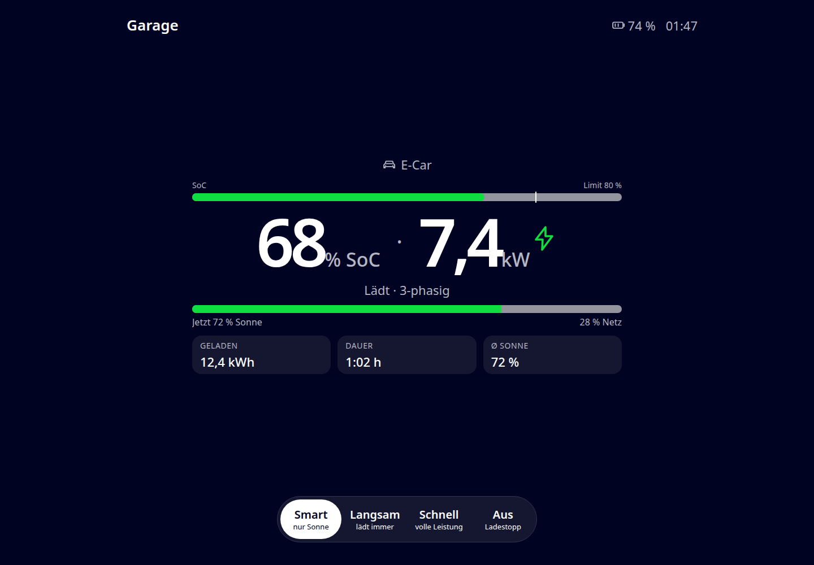
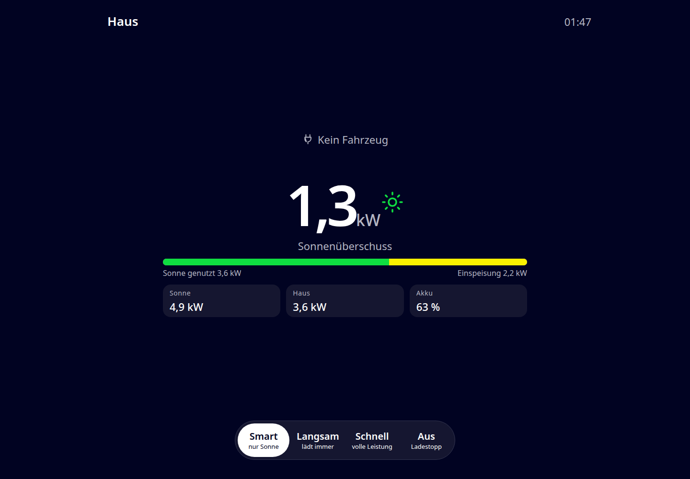

# evcc minimalistic charger GUI

A compact, responsive web display for evcc. A single Go process serves the UI and proxies its small set of required API calls to evcc; no separate web server or JavaScript dependencies are needed.

The display is inspired by and based on [evcc-garage-display](https://github.com/tobymarks/evcc-garage-display).

This project was created with GitHub Copilot.

## Screenshots

### Charging point



### House energy flow



## Run

Requires Go 1.22 or newer:

```sh
go run . --port 8080 --evcc http://192.168.1.20:7070
```

Then open `http://<server>:8080/`. The `--evcc` option can also be set with `EVCC_URL`; its default is `http://127.0.0.1:7070`. The server binds to all interfaces. Build a self-contained executable with:

```sh
go build -o evcc-display .
./evcc-display --port 8080 --evcc http://192.168.1.20:7070
```

Use `--disable-control` to prevent all charging-mode changes on the server, even if a browser URL requests `?control=1`:

```sh
./evcc-display --port 8080 --evcc http://192.168.1.20:7070 --disable-control
```

In this case the mode buttons remain visible but disabled, and the display shows a warning when `control=1` was requested.

The Go process serves the embedded HTML, CSS, JavaScript, and translations and makes same-origin requests to evcc. This avoids browser CORS requirements. The browser should be able to reach this app; only the app process needs to reach evcc.

## Build, install, and Debian package

The Makefile builds a Linux executable and can install it with a systemd unit and configuration file:

```sh
make
sudo make install
sudo editor /etc/default/evcc-minimalistic-charger-gui.env
sudo systemctl daemon-reload
sudo systemctl enable --now evcc-minimalistic-charger-gui
```

Set `EVCC_URL` to the evcc server URL and `PORT` to the display's listening port in `/etc/default/evcc-minimalistic-charger-gui.env`. Set `DISABLE_CONTROL=true` there to force-disable charging controls server-side. The service runs with a dynamically allocated unprivileged user. To install into a staging directory instead of the host system, use `make install DESTDIR=/path/to/stage`.

Create a Debian package for the current machine's architecture with:

```sh
make deb
sudo apt install ./build/evcc-minimalistic-charger-gui_0.1.0_$(dpkg --print-architecture).deb
```

The package installs the same systemd unit and configuration file. `VERSION` can be overridden when building, for example `make deb VERSION=1.2.3`. After installation, update the config file if needed, then enable and start the service with `sudo systemctl enable --now evcc-minimalistic-charger-gui`.

## URL options

Pass options as query parameters on the display URL, for example:

```text
http://display-host:8080/?control=1&preselect=2&preselectTimeout=60&screenTimeout=120&theme=dark&lang=de
```

| Parameter          | Default          | Description                                                                                                                                                                                                              |
| ------------------ | ---------------- | ------------------------------------------------------------------------------------------------------------------------------------------------------------------------------------------------------------------------ |
| `control`          | `0`              | The **Smart**, **Slow**, **Fast**, and **Off** buttons are always shown. Set to `1` to enable them; at `0` they are disabled. A server started with `--disable-control` keeps them disabled and shows a warning.             |
| `autoSwitch`       | `1`              | Automatically switch to a newly connected vehicle or a loadpoint whose charging state changed. Set to `0` to disable. As in the source display, automatic switching is suppressed for 60 seconds after user interaction. |
| `preselect`        | none             | evcc loadpoint number to return to after manual browsing, **1-based** as in evcc (for example `2`). It must be included by the allow/block list.                                                                         |
| `preselectTimeout` | `60`             | Seconds without user interaction before returning to `preselect`. `0` disables the return.                                                                                                                               |
| `screenTimeout`    | `120`            | Seconds without charging or interaction before the display goes completely black. `0` keeps it on. With `preselect`, only that loadpoint counts, and the timer runs only while it is displayed. Tap anywhere to wake it. |
| `theme`            | `dark`           | `dark` or `light`.                                                                                                                                                                                                       |
| `lang`             | browser language | Translation language (`de` or `en`). A regional tag such as `de-CH` uses its base language; unsupported languages fall back to English.                                                                                  |
| `allowlist`        | all loadpoints   | Comma-separated evcc loadpoint numbers to show, e.g. `allowlist=1,3`.                                                                                                                                                    |
| `blocklist`        | none             | Comma-separated evcc loadpoint numbers to hide, e.g. `blocklist=2`. Cannot be used with `allowlist`.                                                                                                                     |

Loadpoints can be switched manually by swiping left/right or clicking the displayed arrows on either side of the mode buttons. The arrows appear when more than one loadpoint is displayed and disable at the first and last loadpoint. Other screen taps do not change the selected loadpoint.

With `control=1`, click the vehicle name to open the vehicle selector. It shows up to six configured evcc vehicles per page; when more are configured, switch pages with the arrows or by swiping. Selecting a vehicle assigns it to that loadpoint and returns to the loadpoint view.

The vehicle selector uses icon names from evcc state and vector paths adapted from evcc's `VehicleIcon` components. See [EVCC-ICONS-LICENSE](web/EVCC-ICONS-LICENSE) for the applicable license.

## Display and controls

The responsive layout scales its spacing and typography with the available viewport and adapts to portrait and landscape aspect ratios. It shows the loadpoint name and time, vehicle, charging power with the vehicle state of charge alongside it, a state-of-charge bar with the lower of the effective and vehicle charging limits (when available), evcc status, solar/grid share, session data, and — when no vehicle is connected and PV data is available — house, solar, and battery flow.

By default, the only interaction is switching loadpoints. When `control=1`, the mode buttons map to evcc as follows:

| Button | evcc API behavior                                               |
| ------ | --------------------------------------------------------------- |
| Smart  | `alwayscharge/off`, then `mode/smart` (older evcc: `mode/pv`)   |
| Slow   | `alwayscharge/on`, then `mode/smart` (older evcc: `mode/minpv`) |
| Fast   | `mode/now`                                                      |
| Off    | `mode/off`                                                      |

## evcc API

The page polls `GET /api/state?jq=…` every three seconds. The jq projection follows `src/evcc_client.cpp` in the source project and requests the loadpoint mode, vehicle, power, charging/session state, plus PV, home, battery, and grid data. Mode buttons proxy `POST /api/loadpoints/{number}/…`.

The server forwards only `GET /api/state` and the supported loadpoint mode/always-charge/vehicle-selection `POST` routes. Vehicle names and icon identifiers come from the state response. It is not a general-purpose proxy. The browser talks to this app on the same origin, so evcc does not need to enable cross-origin access.
